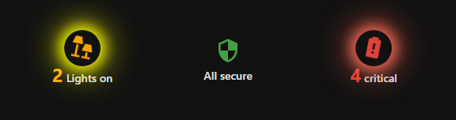
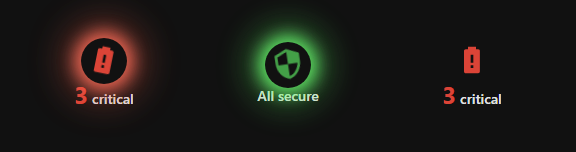

# Summary Count Card

A compact Home Assistant Lovelace card that counts entities in a given state and navigates to a target view when tapped. Lightweight, dependency-free, and optional animated.



*Left to right: lights on, all secure, critical batteries — default dark theme, icons animated.*

## Features

- **Count entities** — lights on, critical batteries, open covers, security issues, switches on, sensors on
- **Critical batteries** — counts `unavailable`/`unknown` AND values below 20% (`device_class: battery`)
- **Optional icon animation** — the same look as an animated lock card: a pulsing glow halo plus a swinging icon, tinted in the current state colour (red = something to act on, green = all clear)
- **Tap navigation** — navigate to any dashboard view on tap (e.g. `/dashboard-neu/batteries`)
- **Theme-compatible** — uses only CSS variables, adapts to any theme, dark or light
- **Visual editor** — pick the count type, target view and animation switches in the UI, no YAML needed
- **Two languages** — automatic labels follow your Home Assistant language (German or English)
- **No dependencies** — pure `HTMLElement`, no Lit runtime, no external libraries

## Installation

### HACS (recommended)
1. Add this repository as a custom repository in HACS (type: Dashboard)
2. Install
3. Restart Home Assistant
4. Add the card to your dashboard

### Manual
1. Copy `summary-count-card.js` to your `www/` directory
2. Add the resource `/local/summary-count-card.js` (type: JavaScript Module)
3. Restart Home Assistant
4. Add the card to your dashboard

## Configuration

### Visual editor
Add a new card, search for "Summary Count", and choose everything in the editor — count type, target view, labels, icon, and the two animation switches.

### YAML

```yaml
type: custom:summary-count-card
count_type: batteries_critical
target_path: /dashboard-neu/batteries
animate: true
animate_active_only: true
```

### Card options

| Option | Type | Default | Description |
|--------|------|---------|-------------|
| `count_type` | string | `batteries_critical` | What to count (see below) |
| `target_path` | string | `""` | Dashboard view to navigate to on tap (e.g. `/dashboard-neu/batteries`) |
| `label` | string | `""` | Custom label (empty = automatic) |
| `icon` | string | `""` | Custom icon (empty = automatic) |
| `show_label` | bool | `true` | Show the label |
| `show_icon` | bool | `true` | Show the icon |
| `color_mode` | string | `"auto"` | `"auto"` or `"none"` |
| `animate` | bool | `false` | Animate the icon (glow halo + swing) |
| `animate_active_only` | bool | `true` | Only animate while the count is above 0 |

### Count types

| `count_type` | Counts | Auto label (en / de) | Auto icon |
|--------------|--------|----------------------|-----------|
| `batteries_critical` | `unavailable`/`unknown` + below 20% (`device_class: battery`) | critical / kritisch | `mdi:battery-alert` |
| `lights` | lights that are `on` | Lights on / Lichter an | `mdi:lamps` |
| `switches_on` | switches that are `on` | Switches on / Schalter an | `mdi:toggle-switch` |
| `sensors_on` | binary sensors that are `on` | Sensors active / Sensoren an | `mdi:motion-sensor` |
| `covers_open` | covers that are `open`/`opening` | Covers open / Rollos offen | `mdi:blinds-horizontal` |
| `security` | unlocked locks, open doors/garages/gates, open windows | unsafe / unsicher | `mdi:security` |

When the count is 0 the card shows the quiet state instead of a number — e.g. "All secure" (green), "All OK", "All off", "All closed", "None active".

## Animation

Two switches in the visual editor: **Animate** and **Only above 0**.

- `animate: true` turns the effect on — the icon swings and glows in the current state colour.
- `animate_active_only: true` (default) keeps the icon still while the count is 0. With it switched off, the icon also animates in the quiet state, using a much subtler motion.



*Left: counting (red, full swing) · middle: quiet state with "Only above 0" off (green, gentle) · right: `animate: false`.*

The glow halo takes the icon's own colour, so it turns red while there is something to act on and green (or the theme's text colour for count types without a state colour) when everything is fine. `prefers-reduced-motion` is respected, so the card stays still for anyone who asked the system to reduce motion.

## Labels and language

Automatic labels follow the language your Home Assistant is set to: German (`de`) or English (everything else). Any single card can override its text with the `label` option, which always wins:

```yaml
type: custom:summary-count-card
count_type: batteries_critical
label: Batteries to check
```

## Security counting details

The `security` count type considers an entity "unsafe" when:

- a `lock` is `unlocked`
- a `cover` with `device_class` door/garage/gate is `open`/`opening`
- a `binary_sensor` with `device_class` door/window/garage_door/opening is `on`

Entities whose id ends in `_status` are skipped — some integrations (e.g. fuel price sensors) report an unrelated `device_class: opening` and would otherwise inflate the count.

## License

MIT
